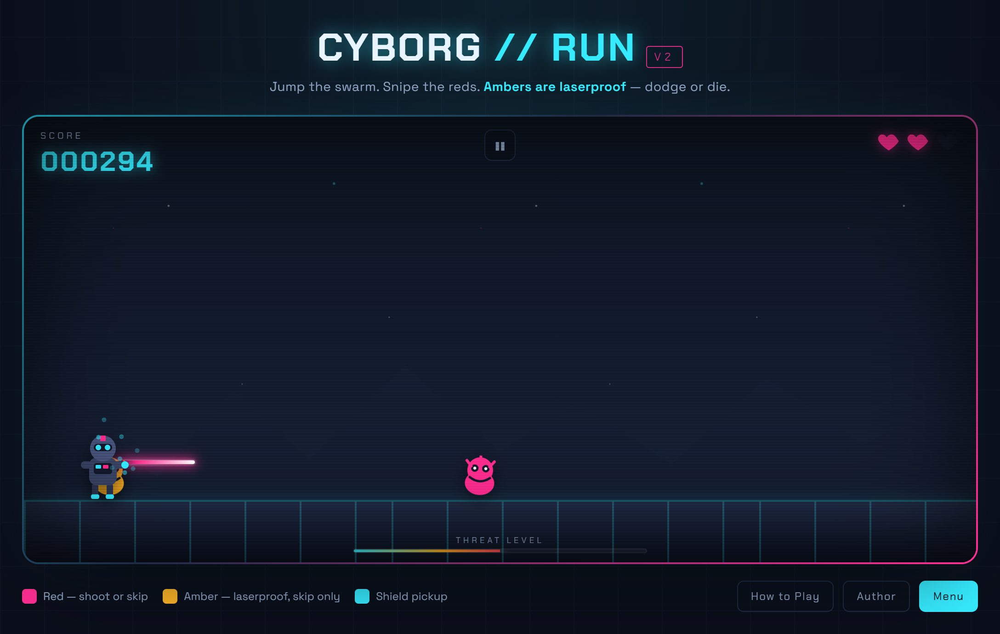
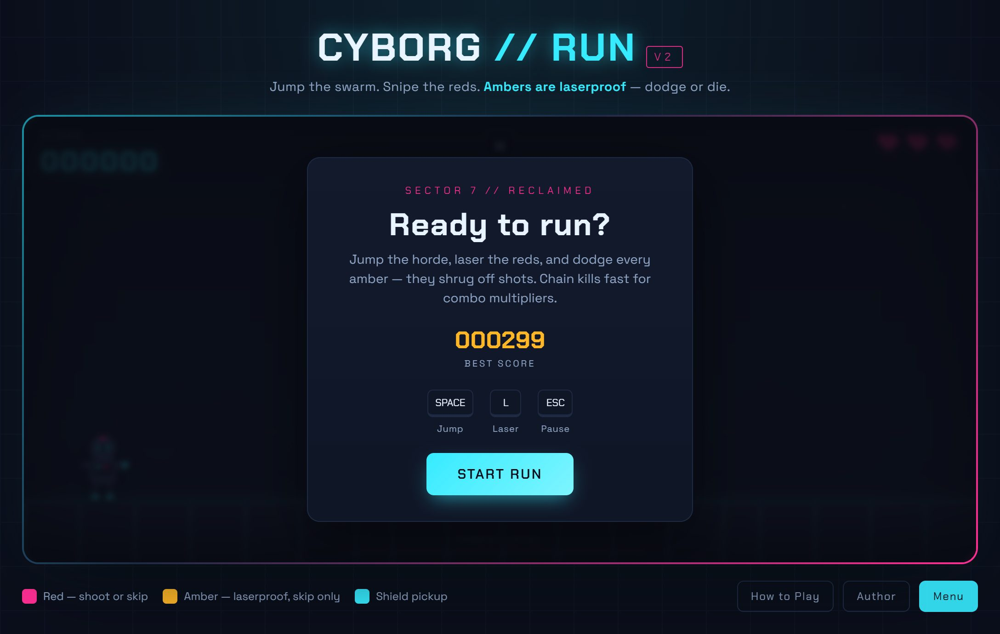
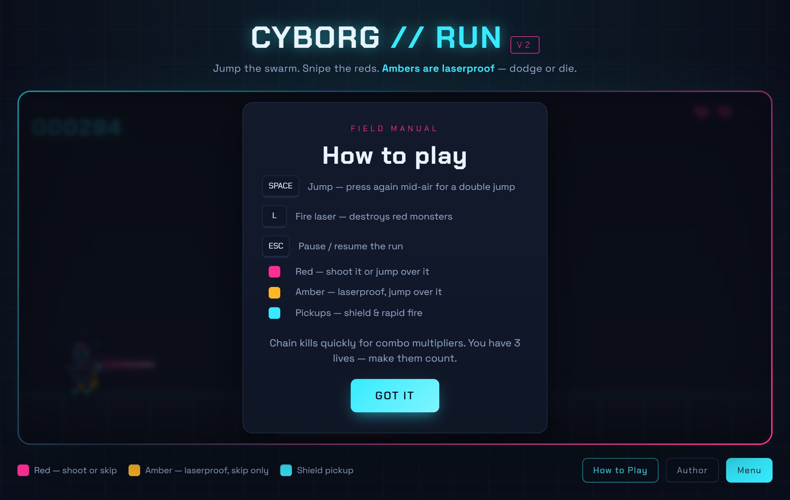
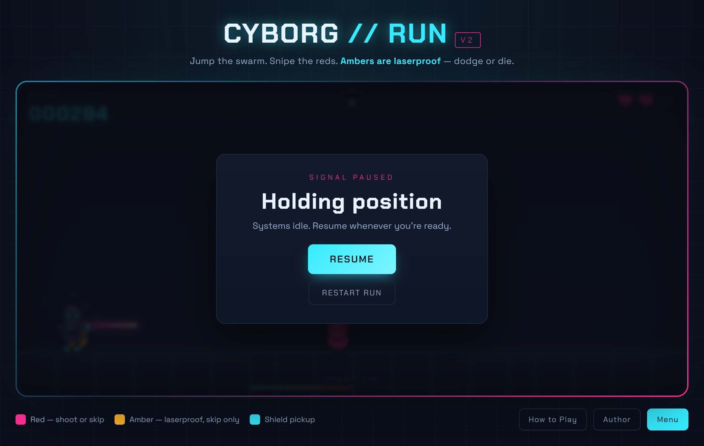
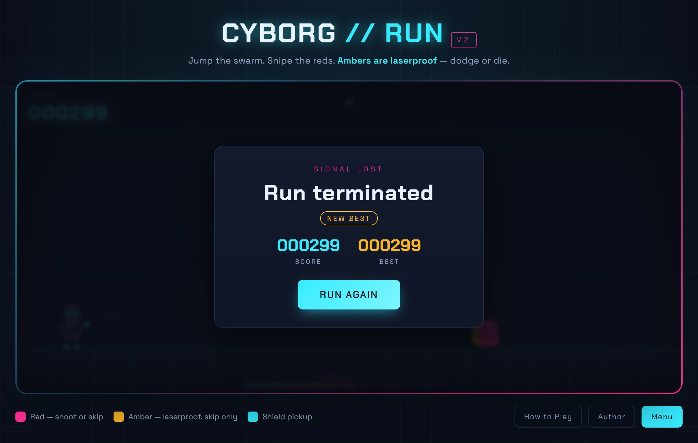
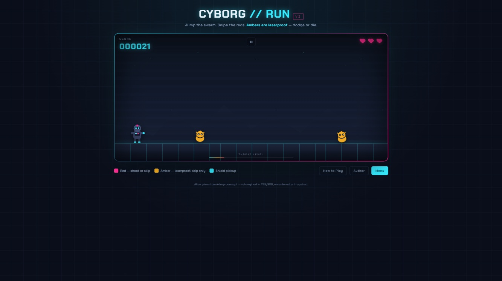

<h1 align="center">CYBORG // RUN v2</h1>

<p align="center">
    Jump the swarm. Snipe the reds. Ambers are laserproof — dodge or die.
</p>

<p align="center">
    <a href="https://goldipl.github.io/Cyborg_Game/"><b>▶ Play live</b></a>
</p>



## Table of contents

- [General info](#general-info)
- [Features](#features)
- [Controls](#controls)
- [Technologies](#technologies)
- [Screenshots](#screenshots)
- [Run locally](#run-locally)
- [Live](#live)

## General info

CYBORG // RUN is a 2D side-scrolling arcade game written in Vanilla JavaScript. You play as a cyborg running across an alien sector overrun by monsters. Jump over them, shoot them down with your laser and survive as long as you can to score as many points as possible.

## Features

- **Two enemy types** — red monsters can be shot or jumped over, amber monsters are laserproof and must be jumped over
- **Double jump** — press jump again mid-air to get extra height
- **Pickups** — a shield that absorbs a hit and rapid fire that shortens the laser cooldown
- **Combo multiplier** — chain kills quickly to multiply your points
- **Rising difficulty** — speed and spawn rate increase over time, shown on the threat level meter
- **3 lives** with brief invulnerability after each hit
- **Best score** saved in the browser (`localStorage`)
- **Pause, How to Play and Menu** screens, plus a parallax background with a CRT-style overlay

## Controls

| Key     | Action                                       |
| ------- | -------------------------------------------- |
| `SPACE` | Jump (press again mid-air for a double jump) |
| `L`     | Fire laser                                   |
| `ESC`   | Pause / resume                               |

> The game needs a keyboard, so it is meant to be played in a desktop browser.

## Technologies

Project was created with:

- HTML5
- CSS3 (animations, inline SVG graphics)
- Vanilla JavaScript (ES6+)

## Screenshots

<table>
  <tr>
    <td align="center" width="50%">
      
      <br />
      <b>Main menu</b> — start screen with controls and your best score
    </td>
    <td align="center" width="50%">
      
      <br />
      <b>Gameplay</b> — shooting a red monster while the threat level rises
    </td>
  </tr>
  <tr>
    <td align="center" width="50%">
      
      <br />
      <b>How to play</b> — controls, enemy types and pickups explained
    </td>
    <td align="center" width="50%">
      
      <br />
      <b>Pause</b> — resume or restart the current run
    </td>
  </tr>
  <tr>
    <td align="center" width="50%">
      
      <br />
      <b>Game over</b> — final score with a "New Best" badge
    </td>
    <td align="center" width="50%">
      
      <br />
      <b>Early run</b> — the cyborg facing two laserproof amber monsters
    </td>
  </tr>
</table>

## Run locally

The whole game lives in a single `index.html` file, so no build step or dependencies are needed.

```bash
git clone https://github.com/goldipl/Cyborg_Game.git
cd Cyborg_Game
```

Then open `index.html` in your browser.

## Live

Wanna play? Click the link below & have fun!

https://goldipl.github.io/Cyborg_Game/
